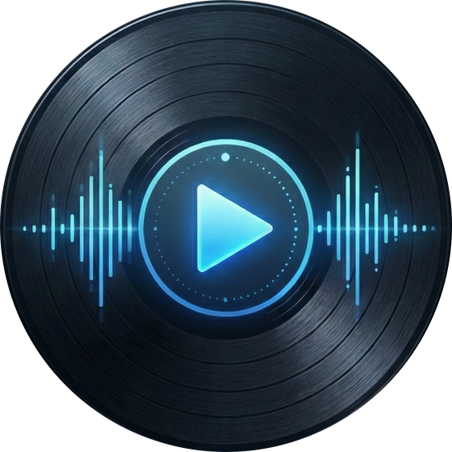

# Sautiflow



**[Download Latest Sautiplay Release](https://github.com/wambugu71/sautiflow/releases/latest)** | **[Join Telegram Community](https://t.me/+MilnrgkNkbFiYmY0)**

*See the [Sautiplay README](sautiplay/README.md) for the player application built on this engine.*

Sautiflow is a cross-platform audio playback and processing engine for Dart and Flutter, built in C++ on miniaudio. It provides playlist management, gapless transitions, DSP effects, and status polling through Dart FFI across Windows, Linux, Android, iOS, and macOS.

## Features

- Playlist management (set, add, insert, remove, move)
- Gapless transitions between tracks
- Sinc resampling with `libsamplerate` (Best, Medium, Fastest, ZOH, Linear)
- Play, pause, stop, seek, next, previous, and jump controls
- Shuffle and loop modes (`off`, `all`, `one`)
- FX chain: gain, pan, stereo widening, headphone crossfeed (BS2B, Joe0bloggs), 3-band EQ, multiband EQ, reverb, low-pass, high-pass, band-pass, delay, peak EQ, notch, low-shelf, and high-shelf
- Player status polling and real-time event streams
- Native targets: Windows, Linux, Android, iOS, and macOS

### Headphone crossfeed

Stereo tracks mastered for speakers can cause listening fatigue on headphones due to extreme channel separation. Sautiflow includes crossfeed processing with three presets:
- **BS2B Weak**: subtle crossfeed with minimal tonal change.
- **BS2B Strong**: stronger acoustic crossfeed for wide-panned stereo mixes.
- **Joe0bloggs Realistic**: delay-based frequency shaping modeled after acoustic speaker bleed.

```dart
// Enable crossfeed
player.setCrossfeedEnabled(enabled: true);

// Set preset (1 = BS2B Weak, 2 = BS2B Strong, 3 = Joe0bloggs)
player.setCrossfeedPreset(preset: 3);
```

## Audio formats and processing

- **Lossy audio (MP3, AAC, OGG)**: decoded into 32-bit floating-point PCM so equalizer, reverb, and spatial processing operate with dynamic headroom without integer clipping.
- **Lossless audio (FLAC, WAV, ALAC)**: processed without synthetic upsampling. When the source sample rate matches the output device, audio passes to hardware bit-exact. When conversion is required (for example, 88.2 kHz audio on a 48 kHz output device), the engine resamples via `libsamplerate`.

## Public Dart API

Import the package:

```dart
import 'package:sautiflow/sautiflow.dart';
```

### Querying pipeline state

Read `player.pipelineState` to inspect active audio stream properties, processing precision, and hardware driver negotiation:

```dart
final state = player.pipelineState;

// Input source properties
print('Input Format: ${state.inputFormatString} | ${state.inputChannels} channels');
print('Input Sample Rate: ${state.inputSampleRate}Hz');

// Internal DSP precision
print('DSP Format: ${state.processingFormatString}');

// Negotiated hardware driver output
print('Speaker Format: ${state.outputFormatString} | ${state.outputSampleRate}Hz');

// Active DSP status
print('EQ Enabled: ${state.eqEnabled}');
print('Reverb Enabled: ${state.reverbEnabled}');
```

### Native track metadata inspection

`player.inspectFile(path)` reads container headers (including FLAC `STREAMINFO` and WAV `fmt ` chunks) without decoding audio frames:

```dart
final info = player.inspectFile('/path/to/song.flac');

if (info != null) {
  print('Sample Rate: ${info.sampleRate} Hz');
  print('Bit Depth:   ${info.bitDepth} bits');
  print('Float PCM:   ${info.isFloat}');
  print('Channels:    ${info.channels}');
  print('Bitrate:     ${info.bitrateKbps} kbps');
  print('Codec:       ${info.formatName}');
}
```

### Playlist and playback controls

```dart
final player = MiniAudioPlayer();
player.init();

final playlist = <AudioSource>[
  AudioSource.uri(Uri.parse('https://example.com/track1.mp3')),
  AudioSource.uri(Uri.parse('https://example.com/track2.mp3')),
  AudioSource.uri(Uri.parse('https://example.com/track3.mp3')),
];

player.setAudioSources(
  playlist,
  initialIndex: 0,
  initialPosition: Duration.zero,
  useLazyPreparation: true,
);

player.play();
player.seekToNext();
player.seekToPrevious();
player.seekTo(Duration.zero, index: 2);
player.setLoopMode(LoopMode.all);
player.setShuffleModeEnabled(true);

player.addAudioSource(AudioSource.uri(Uri.parse('https://example.com/new.mp3')));
player.insertAudioSource(1, AudioSource.uri(Uri.parse('https://example.com/ins.mp3')));
player.removeAudioSourceAt(3);
player.moveAudioSource(2, 1);

player.setEqEnabled(true);
player.setEq(low: 1.2, mid: 1.0, high: 1.1);
player.setReverbEnabled(true);
player.setReverb(mix: 0.2, feedback: 0.6, delayMs: 100);

// Parametric shaping
player.setBandpass(enabled: true, cutoffHz: 1000, q: 0.8);
player.setPeakEq(enabled: true, gainDb: 3.0, q: 1.0, frequencyHz: 2500);
player.setNotch(enabled: true, q: 10.0, frequencyHz: 60);
player.setLowshelf(enabled: true, gainDb: 4.0, slope: 1.0, frequencyHz: 100);
player.setHighshelf(enabled: true, gainDb: 2.5, slope: 1.0, frequencyHz: 10000);
```

## Native build outputs

Library binaries by platform:

- Windows: `sautiflow.dll`
- Linux and Android: `libsautiflow.so`
- macOS: `libsautiflow.dylib`
- iOS: statically linked (`DynamicLibrary.process()`)

## Flutter plugin configuration

Configured as a Flutter FFI plugin in [pubspec.yaml](pubspec.yaml) for:

- Android (`ffiPlugin: true`)
- iOS (`ffiPlugin: true`)
- Linux (`ffiPlugin: true`)
- Windows (`ffiPlugin: true`)

Platform build definitions:

- [android/src/main/cpp/CMakeLists.txt](android/src/main/cpp/CMakeLists.txt)
- [ios/sautiflow.podspec](ios/sautiflow.podspec)
- [linux/CMakeLists.txt](linux/CMakeLists.txt)
- [windows/CMakeLists.txt](windows/CMakeLists.txt)

## Build scripts

- Windows: [tool/build_windows.ps1](tool/build_windows.ps1)
- Linux: [tool/build_linux.sh](tool/build_linux.sh)
- Android (NDK, Bash): [tool/build_android.sh](tool/build_android.sh)
- Android (NDK, PowerShell): [tool/build_android.ps1](tool/build_android.ps1)
- Apple (iOS and macOS): [tool/build_apple.sh](tool/build_apple.sh)

## Packaging

Place native binaries where the platform loader can find them:

- Android: `android/src/main/jniLibs/<abi>/libsautiflow.so`
- iOS: link `sautiflow.xcframework` in Xcode or Podspec
- Windows: place `sautiflow.dll` alongside the executable
- Linux: bundle `libsautiflow.so` with the application and configure RPATH

### Android network streaming (libcurl)

Android attempts native URL streaming by default:

- When `libcurl` is detected (via explicit path or bundled per ABI), native network streaming is enabled.
- If not detected, the build continues and falls back to non-native stream handling.

Gradle configuration properties:

- `MINIAUDIODART_ENABLE_CURL=ON|OFF`
- `MINIAUDIODART_CURL_INCLUDE_DIR=/path/to/include`
- `MINIAUDIODART_CURL_LIBRARY=/path/to/libcurl.a` (or `.so`)
- `MINIAUDIODART_CURL_LIBRARY_DIR=/path/to/abi-parent`
- `MINIAUDIODART_CURL_EXTRA_LIBS=ssl;crypto;z`

### Android static curl setup

Using static `libcurl.a` keeps plugin packaging inside a single `libsautiflow.so`.

Expected layout:

- `native/android/include/` (curl headers)
- `native/android/armeabi-v7a/libcurl.a`
- `native/android/arm64-v8a/libcurl.a`

Android Gradle targets ARM ABIs by default (`armeabi-v7a`, `arm64-v8a`). To target emulator ABIs (`x86`, `x86_64`), provide matching curl libraries and expand ABI filters.

## DSP architecture

- **Sauti DSP engine**: clarity enhancer, harmonic bass, transducer correction, analog warmth saturation, partitioned FFT impulse response convolution, and lookahead peak limiting.

## Example

See [example/main.dart](example/main.dart) for a complete implementation.

## Community

Join the Telegram group for development updates, bug reports, and discussion:
[Join Sautiplay / Sautiflow Telegram Group](https://t.me/+MilnrgkNkbFiYmY0)

## Support

If you find this project useful, you can support development:

<a href="https://buymeacoffee.com/wambugu" target="_blank"></a>

The API design is inspired by `just_audio`, backed by a native C++ engine for low-latency processing and direct DSP control.

## License

This project is licensed under the GNU General Public License v3.0 (GPL-3.0). See [LICENSE](LICENSE) for details.

Third-party attributions and licenses (miniaudio, FFmpeg, libsamplerate, r8brain) are documented in [THIRD_PARTY_NOTICES.md](THIRD_PARTY_NOTICES.md).
