# Comprehensive Technical Audit Report: Sautiflow Audio Engine Architecture, Real-Time Safety & Audiophile Fidelity

**Date:** September 2026  
**Target Codebase:** `sautiflow` / `miniaudiodart`  
**Scope of Review:** Real-time audio render callback (`data_callback`), background decoder/producer thread architecture (`decode_producer_loop`, `worker_loop`), clock domains & sample rate negotiation, DSP suite (`dsp/`), r8brain & libswresample resampling backends, dither topologies, multichannel routing, and Dart FFI bindings.

---

## 1. Executive Summary & Audiophile Verdict

### Overall Grade: **B** (Consumer High-Fidelity; Not Currently Bit-Perfect Audiophile / Mastering Grade)

The Sautiflow engine demonstrates substantial engineering ambition. It integrates Alexey Lukin’s industry-standard **r8brain** 64-bit polyphase sinc resampler, high-pass shaped TPDF dithering with exact integer-grid roundoff, custom AVX2/NEON vector math, a Dattorro figure-8 reverb topology, ITU-R BS.1770-4 loudness gating, and an expansive suite of clean-room DSP nodes.

However, an exhaustive audit across all subsystems reveals **critical architectural bugs, real-time safety violations, and mathematical DSP flaws** that currently compromise system stability and prevent bit-perfect high-resolution reproduction:

| Dimension | Current State | Audiophile Target | Rating |
| :--- | :--- | :--- | :---: |
| **Bit-Perfect Pass-Through** | Auto Sample-Rate Matching is completely broken engine-wide; 32-bit float output path invokes Undefined Behavior (`memcpy` overlap). | Zero corruption, exact bit-grid pass-through, hardware DAC rate tracking. | **C** |
| **Clock & Rate Negotiation** | Engine checks `decoder->outputSampleRate` instead of track native rate in 5 sites, preventing DAC hardware rate switching. | Dynamic DAC reconfiguration to match file rate without software resampling. | **D (Broken)** |
| **Real-Time Safety (Glitch-Free)** | Realtime callback takes blocking mutexes, flushes `stderr`, resizes heap vectors, and risks an unbounded memory leak in r8brain FIFO. | Strictly lock-free, zero heap allocation, zero file/console I/O on render thread. | **C-** |
| **DSP Precision & Anti-Aliasing** | 64-bit pipeline suffers repeated 32-bit truncation; oversampler has only 33 dB stopband attenuation and 0.7 dB ripple. | Continuous 64-bit double precision; oversampler stopband attenuation $\ge 96\text{ dB}$, ripple $< 0.001\text{ dB}$. | **C+** |
| **Limiter & Dynamic Ballistics** | Master limiter release equation has an inverted step coefficient, releasing gain in 1 sample (~20 µs) rather than 60 ms. | True smooth exponential release ballistics with zero audible chatter. | **D (Broken)** |
| **Crossfade & Track Transition** | Crossfade mixer reads old decoder without rate conversion; crossfading 44.1k to 96k plays old track at 2.17x pitch/tempo. | Independent rate-matched crossfade resampling with artifact-free gain taper. | **F (Broken)** |
| **Multichannel (5.1/7.1) Integrity** | Stereo DSP modules corrupt multichannel audio; Tape Drift delays L/R by 15 ms while Center plays un-delayed. | Full multichannel matrix awareness, channel-specific processing, and phase coherence. | **F (Corrupted)** |
| **Resampling Quality** | r8brain 64-bit sinc resampler provides ultra-low jitter, but pitch-shifter uses coarse linear interpolation. | Pristine polyphase sinc interpolation across both playback and varispeed paths. | **A-** |
| **Dither & Quantization** | High-pass TPDF dither is excellent, but psychoacoustic noise shapers apply 44.1 kHz curves to 96k/192k audio. | Psychoacoustically shaped dither calibrated dynamically for the active sample rate. | **B+** |

---

## 2. End-to-End Signal Path & Clock Domain Architecture

```mermaid
flowchart TD
    subgraph Decoder_Producer_Thread ["Producer / Decoder Thread (decode_producer_loop)"]
        SRC_IN["Audio Source: Local File / HTTP Stream / Push Chunk"] --> DEC["Decoder: FFmpeg / miniaudio"]
        DEC --> RATE_CHECK{"Auto-SR Match? (Checks outputSampleRate [P0.6 BUG])"}
        RATE_CHECK --> PITCH_SCALE["Varispeed / Pitch Shifter (Linear Interpolator [P2.3 BUG])"]
        PITCH_SCALE --> WSOLA["ScaleTempo WSOLA Time-Stretching"]
        WSOLA --> CF_MIX["Crossfade Transition Mixer (No Resampling on fadeOut [P0.8 BUG])"]
        CF_MIX --> RING_IN["Write to pcmRingBuffer (SPSC lock-free)"]
    end

    RING_IN -.->|"pcmRingBuffer (16,384 frames capacity)"| RING_OUT["Read from pcmRingBuffer"]

    subgraph RealTime_Audio_Thread ["Real-Time DAC Thread (data_callback)"]
        RING_OUT --> LOCK_NOTIFY["decodeProducerMutex.lock() [P0.1 PRIORITY INVERSION]"]
        LOCK_NOTIFY --> S1["Stage 1: Pre-Gain (ReplayGain without Peak Limiting [P1.8 BUG])"]
        S1 --> SUBSONIC["Subsonic Rumble Filter (18 Hz Butterworth HPF)"]
        SUBSONIC --> PRE_FX["Pre-FX (Crossfeed, Stereo Width, Reverb)"]
        PRE_FX --> TRUNC_1["64-bit to 32-bit Truncation Ping-Pong [P1.2 PRECISION LOSS]"]
        TRUNC_1 --> EQ_STAGE["Parametric & Dynamic EQ (ma_peak2_init wipes state [P1.6 ZIPPER BUG])"]
        EQ_STAGE --> DSP_SUITE["Native DSP Suite (9 stereo modules assume 2-ch stride [P0.4 5.1 CORRUPTION])"]
        DSP_SUITE --> LIMITER["Master Limiter (1-sample release equation [P0.3 DISTORTION BUG])"]
        LIMITER --> VOL_STAGE["Master Volume Gain Ramping & Dynamic Loudness"]
        VOL_STAGE --> POST_LIMIT["Brickwall Peak Safety Guard"]
        POST_LIMIT --> S5_SRC{"engineSampleRate != deviceSampleRate?"}
        S5_SRC -->|Yes| R8B["r8brain 64-bit Sinc Resampler (outputFifo Unbounded Leak [P0.7 BUG])"]
        S5_SRC -->|No| S5_PASS["Direct Passthrough"]
        R8B --> DITHER["Dithering (44.1kHz Shibata curves applied at 96k/192k [P2.4 BUG])"]
        S5_PASS --> DITHER
        DITHER --> CONV["Exact Integer Grid Rounding (f32ToIntExact)"]
        CONV --> F32_OUT{"Format == F32?"}
        F32_OUT -->|Yes| MEMCPY_UB["memcpy(pOutput, pOutput) [P0.2 UNDEFINED BEHAVIOR]"]
        F32_OUT -->|No| INT_OUT["Write to Hardware PCM Buffer"]
    end

    MEMCPY_UB --> DAC["Hardware DAC / Audio Endpoint (WASAPI Exclusive / CoreAudio / AAudio)"]
    INT_OUT --> DAC
```



---

## 3. P0: Critical Flaws, Data Corruption & Undefined Behavior

### P0.1 Priority Inversion in Real-Time Callback via `decodeProducerMutex`
- **Location:** [`audio_engine.cpp:5955-5957`](file:///c:/Users/wambugukinyua/miniaudiodart/audio_engine.cpp#L5955-L5957) vs [`audio_engine.cpp:10882`](file:///c:/Users/wambugukinyua/miniaudiodart/audio_engine.cpp#L10882)
- **Mechanism:** In the real-time audio callback (`data_callback`), the engine attempts to wake the producer thread by acquiring a standard blocking mutex:
  ```cpp
  // audio_engine.cpp:5955
  std::unique_lock<std::mutex> lk(e->decodeProducerMutex);
  e->decodeProducerCv.notify_one();
  ```
  Meanwhile, in `ae_push_stream_chunk`:
  ```cpp
  // audio_engine.cpp:10882
  std::unique_lock<std::mutex> lk(e->decodeProducerMutex);
  std::this_thread::sleep_for(std::chrono::milliseconds(2));
  ```
- **Consequence:** An OS thread executing `sleep_for(2ms)` while holding `decodeProducerMutex` will block the DAC audio callback thread when buffer underflow approaches. This causes buffer underruns, audible dropouts, and audio stuttering.
- **Audiophile Impact:** Violates the fundamental rule of real-time audio programming: **never acquire a non-real-time mutex inside an audio callback.**

---

### P0.2 Undefined Behavior in F32 Output Path: `memcpy` with Overlapping Pointers
- **Location:** [`audio_engine.cpp:6792-6795`](file:///c:/Users/wambugukinyua/miniaudiodart/audio_engine.cpp#L6792-L6795)
- **Mechanism:** In `data_callback`:
  ```cpp
  // audio_engine.cpp:5886
  if (e->outputFormat == AE_FORMAT_F32) {
      processBuffer = reinterpret_cast<float *>(pOutput);
  }
  // audio_engine.cpp:6663
  float *finalDstBuffer = (e->outputFormat == AE_FORMAT_F32) ? reinterpret_cast<float *>(pOutput) : e->conversionBuffer.data();
  // ...
  // audio_engine.cpp:6792-6795
  else if (pDevice->playback.format == ma_format_f32)
  {
      std::memcpy(pOutput, finalDstBuffer, totalSamples * sizeof(float));
  }
  ```
- **Consequence:** When `e->outputFormat == AE_FORMAT_F32` and `needsDeviceSRC == false` (the standard audiophile 1:1 playback mode), `pOutput` and `finalDstBuffer` point to the identical memory address. Calling `std::memcpy(pOutput, pOutput, size)` invokes **C/C++ Undefined Behavior** (violating ISO/IEC 9899 §7.24.2.1 and C++ standard §21.5.3). Compilers optimizing with AVX2 vectorized `memcpy` may emit unaligned self-corrupting operations, triggering crashes or ASan/UBSan traps.

---

### P0.3 Master Limiter Mathematical Bug: Instantaneous 1-Sample Release
- **Location:** [`dsp/master_limiter_dsp.h:108-112`](file:///c:/Users/wambugukinyua/miniaudiodart/dsp/master_limiter_dsp.h#L108-L112)
- **Mechanism:**
  ```cpp
  // dsp/master_limiter_dsp.h:180
  release_coeff_ = std::exp(-1.0f / (sample_rate_ * (release_ms_ * 0.001f)));
  release_smooth_coeff_ = release_coeff_;
  // ...
  // dsp/master_limiter_dsp.h:108-112
  if (target_gain < current_gain_) {
      current_gain_ = target_gain;
  } else {
      current_gain_ += release_smooth_coeff_ * (target_gain - current_gain_);
  }
  ```
  At $48\text{ kHz}$ with a $60\text{ ms}$ release, $\tau = 48000 \times 0.060 = 2880\text{ samples}$.  
  $\text{release\_smooth\_coeff\_} = e^{-1/2880} \approx \mathbf{0.999653}$.  
  Because the update equation is:
  $$\Delta g = \alpha \cdot (g_{\text{target}} - g)$$
  the limiter recovers **99.965% of the gain reduction in the very first sample** ($20\ \mu\text{s}$) instead of smoothing over $60\text{ ms}$!
- **Consequence:** Whenever peak clamping engages, the limiter gain jumps back to $1.0$ instantly on the following sample. This creates harsh intermodulation buzz, harmonic spray, and audible distortion when peaks exceed the ceiling.

---

### P0.4 Multichannel (5.1 & 7.1) Audio Scrambling Across Native DSP Suite
- **Location:** [`audio_engine.cpp:6345-6375`](file:///c:/Users/wambugukinyua/miniaudiodart/audio_engine.cpp#L6345-L6375)
- **Mechanism:**
  ```cpp
  if (e->channels >= 2)
  {
      // ...
      e->downwardExpanderDsp.process(processBuffer, produced);
      e->harmonicBassDsp.process(processBuffer, produced);
      e->dynamicSystemDsp.process(processBuffer, produced);
      e->analogWarmthDsp.process(processBuffer, produced);
      e->dialogEnhancerDsp.process(processBuffer, produced);
      e->clarityDsp.process(processBuffer, produced);
      e->deEsserDsp.process(processBuffer, produced);
      e->fftConvolverDsp.process(processBuffer, produced);
      e->masterLimiterDsp.process(processBuffer, produced);
  }
  ```
  All of these DSP modules expect interleaved stereo (`[L0, R0, L1, R1, ...]`) and process $2 \times \text{produced}$ consecutive floats.  
  In a 5.1 stream (`channels = 6`), the buffer layout is:
  $$[L_0, R_0, C_0, LFE_0, Ls_0, Rs_0, L_1, R_1, C_1, LFE_1, \dots]$$
- **Consequence:** The DSP modules treat $[C_0, LFE_0]$ as a stereo pair ($L_1, R_1$) and $[Ls_0, Rs_0]$ as another stereo pair ($L_2, R_2$). They process only the first $33\%$ of the buffer as pseudo-stereo, scramble the center dialog and subwoofer channels with stereo enhancement, and leave the remaining $67\%$ of the audio buffer completely untouched.

---

### P0.5 `FFTConvolverDSP` Uncompensated Block Latency Causing Comb Filtering
- **Location:** [`dsp/fft_convolver_dsp.h:214-274`](file:///c:/Users/wambugukinyua/miniaudiodart/dsp/fft_convolver_dsp.h#L214-L274)
- **Mechanism:** The class claims "Zero-Latency Seamless Dry/Wet Crossfading", but uses a uniform partitioned overlap-add architecture with `BLOCK_SIZE = 512`. In `process()`:
  ```cpp
  interleaved_samples[in_idx] = (dry_in_l * eff_dry) + (wet_l * eff_wet);
  ```
  `dry_in_l` is the incoming real-time sample arriving at time $t$.  
  `wet_l` is read from `out_buf_l_`, which contains the convolved output of the **previous** 512-sample block.
- **Consequence:** The wet signal has an uncompensated 512-sample delay ($\approx 10.7\text{ ms}$ at $48\text{ kHz}$, $11.6\text{ ms}$ at $44.1\text{ kHz}$). When a user blends wet and dry signals ($0 < \text{dry} < 1$, $0 < \text{wet} < 1$, e.g. for room simulation or speaker modeling), summing the real-time dry signal with the delayed wet signal produces severe **comb filtering** with spectral notches every $\Delta f \approx 93.75\text{ Hz}$.
- **Remediation:** Introduce a 512-sample circular delay line for the dry path (`dry_delay_l_`, `dry_delay_r_`) within `FFTConvolverDSP`. When the convolver is active, blend the 512-sample delayed dry signal with the 512-sample delayed wet signal to guarantee perfect phase coherence. Maintain smooth anti-pop crossfading between real-time dry and latency-compensated wet/dry mix during activation and deactivation.

---

### P0.6 Broken Auto Sample-Rate Matching Engine-Wide (Dead Feature)
- **Locations:** [`audio_engine.cpp:4807-4810`](file:///c:/Users/wambugukinyua/miniaudiodart/audio_engine.cpp#L4807-L4810), [`L5377-5378`](file:///c:/Users/wambugukinyua/miniaudiodart/audio_engine.cpp#L5377-L5378), [`L5722-5723`](file:///c:/Users/wambugukinyua/miniaudiodart/audio_engine.cpp#L5722-L5723), [`L8150-8153`](file:///c:/Users/wambugukinyua/miniaudiodart/audio_engine.cpp#L8150-L8153), [`L8223-8225`](file:///c:/Users/wambugukinyua/miniaudiodart/audio_engine.cpp#L8223-L8225)
- **Mechanism:**
  ```cpp
  // audio_engine.cpp:8150-8153
  if (e->autoSampleRateMatchEnabled.load(std::memory_order_relaxed) && newCurrent != nullptr)
  {
      const int nativeRate = (int)newCurrent->outputSampleRate;
      if (nativeRate > 0 && nativeRate != e->outputSampleRate)
      {
          // Trigger DAC rate change...
      }
  }
  ```
  `load_decoder_for_path` initializes the decoder by requesting `cfg.sampleRate = targetRate = e->outputSampleRate` (e.g., 48000 Hz). In miniaudio, `decoder->outputSampleRate` stores the requested converted output rate, **NOT** the track’s native source rate!
- **Consequence:** `newCurrent->outputSampleRate` is *always* identical to `e->outputSampleRate`. The comparison `nativeRate != e->outputSampleRate` evaluates to **`false` on every track transition**. Auto Sample-Rate Matching **never triggers**, and high-resolution files (96 kHz, 192 kHz) are silently downsampled to 48 kHz rather than switching the DAC hardware to true native rates!
- **Remediation:** Query the true track format via `ma_decoder_get_data_format(decoder, &fmt, &ch, &nativeRate, nullptr, 0)`.

---

### P0.7 [RESOLVED] Real-Time Allocation Risk in `R8brainBackend::outputFifo`
- **Location:** [`audio_engine.cpp:842-1080`](file:///c:/Users/wambugukinyua/miniaudiodart/audio_engine.cpp#L842-L1080)
- **Status:** **RESOLVED** via `R8brainRingBuffer` (pre-allocated circular ring buffer).
- **Mechanism:** Formerly, `outputFifo` was a `std::vector<float>` that resized inside `r8b_onProcess`. Analysis proved the memory growth was bounded to a single chunk ($\approx 35\text{ KB}$), but dynamic resizing on the real-time audio thread posed priority inversion and audio glitch hazards.
- **Resolution:** Replaced `std::vector<float> outputFifo` with a pre-allocated `R8brainRingBuffer` initialized during `r8b_onInit` and `r8b_onSetRate`. Writes use `writeFromDeinterleaved` directly from `r8brain` buffers, and reads use `readInterleaved`. Zero heap allocations now occur during processing callbacks.

---

### P0.8 Crossfade Pitch and Tempo Doubling on Sample Rate Mismatch
- **Location:** [`audio_engine.cpp:5136-5154`](file:///c:/Users/wambugukinyua/miniaudiodart/audio_engine.cpp#L5136-L5154) vs [`audio_engine.cpp:5988-6001`](file:///c:/Users/wambugukinyua/miniaudiodart/audio_engine.cpp#L5988-L6001)
- **Mechanism:** During a crossfade between two tracks with different native sample rates (e.g. Track 1 @ 44.1 kHz, Track 2 @ 96 kHz):
  ```cpp
  // audio_engine.cpp:5144
  const ma_result rr = ma_decoder_read_pcm_frames(fadeOut, tempChunk.data(), (ma_uint64)fillFrames, &framesRead);
  if (framesRead > 0)
  {
      e->crossfadeRingBuffer.write(tempChunk.data(), (size_t)framesRead * ch);
  }
  ```
  `fadeOut` decodes audio at its native rate directly into `crossfadeRingBuffer`.  
  In the real-time callback:
  ```cpp
  // audio_engine.cpp:5988-5996
  size_t neededMixSamples = (size_t)produced * (size_t)e->channels;
  gotSamples = e->crossfadeRingBuffer.read(e->crossfadeMixBuffer.data(), neededMixSamples);
  ```
- **Consequence:** The render callback reads `produced` samples (running at 96 kHz) directly from the 44.1 kHz buffer without any rate conversion. Consuming 96,000 frames per second from a 44,100 Hz stream causes the fading-out track to play at **$2.17\times$ speed and chipmunk pitch** during the entire crossfade duration.

---

## 4. P1: High-Severity DSP & Playback Integrity Flaws

### P1.1 Polyphase Oversampler Stopband Rejection & Passband Ripple
- **Location:** [`dsp/oversampler.h:15, 256-263`](file:///c:/Users/wambugukinyua/miniaudiodart/dsp/oversampler.h#L15)
- **Analysis:** The 23-tap symmetric half-band FIR filter achieves only **> 33 dB stopband attenuation** and **< 0.7 dB passband ripple**.
  1. **Stopband Attenuation:** Audiophile anti-aliasing standards require $\ge 96\text{ dB}$ to $120\text{ dB}$ rejection. At 33 dB, nonlinear harmonics generated in `analog_warmth_dsp` or `clarity_dsp` fold back across the Nyquist boundary attenuated by only $\approx 33\text{ dB}$ ($\approx 2.2\%$ distortion), creating audible intermodulation distortion and high-frequency hash.
  2. **Passband Ripple:** 0.7 dB of ripple within the $20\text{ Hz} - 20\text{ kHz}$ audible band introduces noticeable frequency response coloration.

---

### P1.2 The "64-Bit Float Precision" Illusion: Repeated Double/Float Truncation
- **Location:** [`audio_engine.cpp:6284, 6298, 6319, 6321, 6352, 6372, 6382, 6384, 6502, 6504, 6591`](file:///c:/Users/wambugukinyua/miniaudiodart/audio_engine.cpp#L6284)
- **Analysis:** Enabling 64-bit mode (`use64`) converts samples from `double` to `float` and back **up to 5 times per audio render block** because native DSP modules only accept `float *`.
- **Consequence:** The 53-bit mantissa precision of 64-bit float is repeatedly truncated down to 24 bits and then zero-extended, defeating the numerical benefits of 64-bit processing while wasting CPU cycles on cast operations.

---

### P1.3 Inaccurate Seeking in FFmpeg Decoder Without Keyframe Preroll Discard
- **Location:** [`ffmpeg_stream_decoder.cpp:1033-1044`](file:///c:/Users/wambugukinyua/miniaudiodart/ffmpeg_stream_decoder.cpp#L1033-L1044)
- **Mechanism:** `av_seek_frame` with `AVSEEK_FLAG_BACKWARD` rewinds to the preceding keyframe, and `m_cursor` is immediately set to `frameIndex` without decoding and discarding priming frames up to `targetPts`.
- **Consequence:** The decoder returns audio starting from the earlier keyframe packet, playing back audio from before the seek position and corrupting playback position synchronization.

---

### P1.4 Audible ~350ms Forward Jump on Sample Rate Change / Device Restart
- **Location:** [`audio_engine.cpp:9697, 9748-9755`](file:///c:/Users/wambugukinyua/miniaudiodart/audio_engine.cpp#L9697)
- **Mechanism:** On sample rate change, `resumeFrame` is obtained via `ma_decoder_get_cursor_in_pcm_frames()`. Because the producer thread decodes ~350 ms ahead into `e->decodeRing`, the cursor is 350 ms ahead of what the DAC actually played.
- **Consequence:** When the new decoder seeks to `resumeFrame`, the ~350 ms of unplayed audio in the ring buffer is discarded, causing the audio to audibly skip forward by ~350 ms.

---

### P1.5 Periodic Silence Injection / Dropouts from Ad-Hoc Resampler Input Frame Estimation
- **Location:** [`audio_engine.cpp:5937-5949`](file:///c:/Users/wambugukinyua/miniaudiodart/audio_engine.cpp#L5937-L5949) vs [`L6685-6704`](file:///c:/Users/wambugukinyua/miniaudiodart/audio_engine.cpp#L6685-L6704)
- **Mechanism:** In `data_callback`, the engine calculates input frames needed for device resampling using:
  ```cpp
  ma_uint64 inNeeded = (ma_uint64)std::ceil((double)frameCount * (double)e->engineSampleRate / (double)e->deviceSampleRate);
  ```
  without querying the resampler backend (`ma_resampler_get_required_input_frame_count`).
- **Consequence:** When r8brain holds back fractional filter latency frames, `outRemaining > 0` occurs in line 6699. Line 6703 then zeroes the remaining samples:
  ```cpp
  std::memset(outPtr, 0, (size_t)outRemaining * (size_t)srcCh * sizeof(float));
  ```
  This injects 1–2 samples of silence into the audio buffer, creating periodic single-sample clicks/dropouts.

---

### P1.6 Filter State Wiping & Loud Zipper Crackle in UI Equalizer Adjustment
- **Location:** [`audio_engine.cpp:3580-3825`](file:///c:/Users/wambugukinyua/miniaudiodart/audio_engine.cpp#L3580-L3825)
- **Mechanism:** In `update_multiband_fx_filters()`, moving any EQ frequency or gain slider calls `ma_peak2_init`, `ma_loshelf2_init`, or `ma_hishelf2_init` for that band.
- **Consequence:** In miniaudio, calling `_init()` resets the filter's internal history registers ($x1, x2, y1, y2$) to zero. Slamming the state registers to zero during active playback introduces immediate waveform step discontinuities, heard as loud **zippering clicks, pops, and crackles** while dragging sliders.

---

### P1.7 Multichannel Acoustic Timing De-synchronization in `TapeDriftDSP`
- **Location:** [`dsp/tape_drift_dsp.h:43, 203-236`](file:///c:/Users/wambugukinyua/miniaudiodart/dsp/tape_drift_dsp.h#L43)
- **Mechanism:** `TapeDriftDSP` hardcodes `kMaxChannels = 2` and delays channels 0 and 1 by $15\text{ ms}$ (`nominal_delay_samples = 0.015 * sampleRate`).
- **Consequence:** In a 5.1 multichannel audio stream, the Left and Right channels are delayed by 15 ms, while the Center (dialog) and Surround channels are passed un-delayed. Center vocals play **15 ms ahead** of the front stereo stage, causing severe acoustic comb filtering and soundstage collapse.

---

### P1.8 Missing ReplayGain Peak Limiting & Potential 0 dBFS Digital Clipping
- **Locations:** [`audio_engine.cpp:4680-4716`](file:///c:/Users/wambugukinyua/miniaudiodart/audio_engine.cpp#L4680-L4716) and [`audio_engine.cpp:5003-5012`](file:///c:/Users/wambugukinyua/miniaudiodart/audio_engine.cpp#L5003-L5012)
- **Mechanism:** When reading metadata tags via `sautiflow::read_file_tags_ffmpeg`:
  ```cpp
  // audio_engine.cpp:5005-5010
  bool hasTags = sautiflow::read_file_tags_ffmpeg(nextPath.c_str(), art, tit, alb, trackGain, albumGain, trackPeak, albumPeak);
  if (hasTags && trackGain != 0.0f)
  {
      float linearGain = std::pow(10.0f, trackGain / 20.0f);
      e->nextTrackReplayGain.store(linearGain, std::memory_order_relaxed);
  }
  ```
  The parsed `trackPeak` value is completely discarded. If a track has `trackGain = +6.0 dB` (linear $2.0$) and a `trackPeak = 0.95` (-0.45 dBFS), the resulting output peak reaches $+5.55\text{ dBFS}$ ($1.90$).
- **Consequence:** Because `masterLimiterDsp` is disabled by default in Stage 3, applying positive ReplayGain causes hard digital clipping against 0 dBFS during output quantization, destroying audio fidelity on quiet or classical tracks.

---

### P1.9 "Bit-Perfect" Exclusive Mode Fails True Bit-Exact Verification
- **Location:** [`audio_engine.cpp:4283, 5757-5804, 5996-6018`](file:///c:/Users/wambugukinyua/miniaudiodart/audio_engine.cpp#L4283)
- **Mechanism:** `bypassAppDsp` skips downstream effect filters, but:
  1. The decoder converts native 16-bit or 24-bit integer PCM into 32-bit float at `engineRate`.
  2. Stage 1 executes ReplayGain and normalization arithmetic prior to bypass evaluation.
  3. Master user gain ($g \times x$) runs on every block, subjecting bits to floating-point multiplication roundoff.
- **Consequence:** Audio passed through "exclusive mode" undergoes float conversion, potential gain multiplication, and requantization dither rather than bit-exact byte streaming directly to the hardware ring.

---

### P1.10 Base-Rate Nonlinear Saturation Aliasing in Non-Oversampled Modules
- **Location:** [`dsp/dynamic_bass_dsp.h:540, 834`](file:///c:/Users/wambugukinyua/miniaudiodart/dsp/dynamic_bass_dsp.h#L540) and [`dsp/dynamic_system_dsp.h:232`](file:///c:/Users/wambugukinyua/miniaudiodart/dsp/dynamic_system_dsp.h#L232)
- **Mechanism:** Harmonic generation and full-band soft-clipping occur at native base sample rates without polyphase oversampling in `DynamicBassDSP` and `DynamicSystemDSP`.
- **Consequence:** Harmonics generated above $f_s/2$ fold back across the Nyquist frequency as inharmonic aliasing distortion, contaminating the audible spectrum with unnatural metallic grain.

---

### P1.11 De-Esser Dynamic Filter Modulations & Instantaneous Hard Knee
- **Location:** [`dsp/de_esser_dsp.h:275, 391-419`](file:///c:/Users/wambugukinyua/miniaudiodart/dsp/de_esser_dsp.h#L275)
- **Mechanism:** `updateShelfCoeffs()` recomputes `std::sin`, `std::cos`, and `std::sqrt` biquad coefficients while dynamic gain moves rapidly. The detector gain curve uses a piecewise hard threshold rather than a true $C^1$-continuous soft knee.
- **Consequence:** Rapid filter coefficient re-calculation inside dynamic signal changes causes transient phase smearing and micro-zippering clicks on vocal sibilance bursts.

---

### P1.12 Dialog Enhancer Cascade Gain Headroom Risk
- **Location:** [`dsp/dialog_enhancer_dsp.h:304-316`](file:///c:/Users/wambugukinyua/miniaudiodart/dsp/dialog_enhancer_dsp.h#L304)
- **Mechanism:** The enhancement chain cascades three peaking filters centered on speech formant bands ($1\text{ kHz}, 2.5\text{ kHz}, 4.5\text{ kHz}$) with cumulative boosts up to $+19.5\text{ dB}$, without internal dynamic gain attenuation or trim compensation.
- **Consequence:** High-level voice tracks quickly clip internally before reaching the master volume stage.

---

## 5. P2: Medium-Severity Code Quality, Telemetry & Edge-Case Flaws

### P2.1 Dynamic Heap Allocations in Real-Time Callback
- **Locations:** [`audio_engine.cpp:6143`](file:///c:/Users/wambugukinyua/miniaudiodart/audio_engine.cpp#L6143) (`processBuffer64.resize`) and [`dsp/clarity_dsp.h:286`](file:///c:/Users/wambugukinyua/miniaudiodart/dsp/clarity_dsp.h#L286) (`sidechain_buf_.resize`).
- **Impact:** Dynamic allocation on the audio thread risks non-deterministic execution times and DAC underruns.

### P2.2 Thread Synchronization & Console I/O in Real-Time Callback
- **Locations:** [`audio_engine.cpp:6015`](file:///c:/Users/wambugukinyua/miniaudiodart/audio_engine.cpp#L6015) and [`audio_engine.cpp:724`](file:///c:/Users/wambugukinyua/miniaudiodart/audio_engine.cpp#L724).
- **Mechanism:** `engine_log(...)` acquires a mutex and calls `vfprintf(stderr)` and `fflush(stderr)` on the real-time audio thread.

### P2.3 Coarse Linear Resampling in Pitch Shifter
- **Location:** [`audio_engine.cpp:5464`](file:///c:/Users/wambugukinyua/miniaudiodart/audio_engine.cpp#L5464).
- **Mechanism:** `pitchResampler` is initialized with `ma_resample_algorithm_linear`.
- **Consequence:** Linear interpolation introduces severe high-frequency roll-off (sinc-squared filtering) and harmonic aliasing during pitch/varispeed manipulation.

### P2.4 Sample-Rate Blind 44.1 kHz Noise Shaping Curves on Hi-Res Audio
- **Location:** [`audio_engine.cpp:2807-2825`](file:///c:/Users/wambugukinyua/miniaudiodart/audio_engine.cpp#L2807-L2825).
- **Mechanism:** Shibata, Lipshitz, and F-weighted 5th-order noise shaping filter coefficients are hardcoded for 44.1 kHz and applied unmodified to 96 kHz and 192 kHz streams.
- **Consequence:** At 96k/192k, the shaped noise peak shifts into the audible ultrasonic transition band rather than near the human hearing threshold.

### P2.5 Stereo Balance Tilt in Spatial Surround Anti-Pop Fade
- **Location:** [`dsp/spatial_surround_dsp.h:589-592`](file:///c:/Users/wambugukinyua/miniaudiodart/dsp/spatial_surround_dsp.h#L589-L592).
- **Mechanism:** `anti_pop_` increments per interleaved sample rather than per stereo frame, giving the Right channel higher gain during fade-in and tilting the soundstage to the right.

### P2.6 Sample-Rate Discrepancy in `AnalogWarmthDSP` Tape Damping
- **Location:** [`dsp/analog_warmth_dsp.h:328`](file:///c:/Users/wambugukinyua/miniaudiodart/dsp/analog_warmth_dsp.h#L328).
- **Mechanism:** `tape_damping_ = clamp(6000.0f / (sample_rate_ * 2.0f))` assumes a 2x rate regardless of whether oversampling is 1x or 4x.

### P2.7 Mislabeled & Inaccurate Telemetry in `ae_get_pipeline_state`
- **Location:** [`audio_engine.cpp:8822-8827`](file:///c:/Users/wambugukinyua/miniaudiodart/audio_engine.cpp#L8822-L8827).
- **Mechanism:** `ps.reverb_enabled = 0;`, `ps.spatialization_enabled = 0;`, and `ps.delay_enabled = 0;` are hardcoded to `0` regardless of whether reverb or spatialization are enabled, returning false telemetry to Dart and UI clients.

### P2.8 Multichannel Silently Ignored in Subsonic Filter
- **Location:** [`dsp/subsonic_filter.h:133-145`](file:///c:/Users/wambugukinyua/miniaudiodart/dsp/subsonic_filter.h#L133-L145).
- **Mechanism:** When `channels == 2`, SIMD optimization processes L/R. When `channels > 2`, fallback handles up to `MAX_CHANNELS = 16`, but mono files share a single state register across all iterations without proper channel indexing.

### P2.9 Mislabeled `AEResamplingPolicyInfo` Metrics
- **Location:** [`audio_engine.cpp:12272`](file:///c:/Users/wambugukinyua/miniaudiodart/audio_engine.cpp#L12272).
- **Mechanism:** `filter_passband_ratio = 0.45 * device_sample_rate` is returned in Hz rather than a dimensionless normalized ratio (e.g. 0.45).

### P2.10 S24 Output Format Mapped to S32 Dead Branch
- **Location:** [`audio_engine.cpp:8904`](file:///c:/Users/wambugukinyua/miniaudiodart/audio_engine.cpp#L8904).
- **Mechanism:** `AE_FORMAT_S24` is mapped internally to `ma_format_s32`, causing the `playback.format == ma_format_s24` branch in `data_callback` to remain dead code.

### P2.11 Inconsistent SRC Fidelity Between Local and Network Streams
- **Location:** [`audio_engine.cpp:4285-4296`](file:///c:/Users/wambugukinyua/miniaudiodart/audio_engine.cpp#L4285-L4296).
- **Mechanism:** Network streaming paths default to FFmpeg `SwrContext` while local files pass through r8brain or SoXR VHQ.

### P2.12 Initial Engine Creation Forces F32 Hardware Format
- **Location:** [`audio_engine.cpp:6980`](file:///c:/Users/wambugukinyua/miniaudiodart/audio_engine.cpp#L6980).
- **Mechanism:** `ae_create_engine` hardcodes `ma_format_f32`; user-configured hardware bit depths only take effect after a subsequent restart.

### P2.13 Unsynchronized Non-Atomic `resampleAlgorithm` Configuration
- **Location:** [`audio_engine.cpp:9574`](file:///c:/Users/wambugukinyua/miniaudiodart/audio_engine.cpp#L9574).
- **Mechanism:** `resampleAlgorithm` is a plain non-atomic `int` written by `ae_set_engine_resample_algorithm` while concurrently read in `applyRatePlan`.

---

## 6. P3: Verification, Profiling & Test Suite Gaps

### P3.1 Oversampling API Getter-Only Verification
- **Analysis:** `tests/test_engine_api.cpp:117-129` verifies only that `ae_get_dsp_oversampling()` returns what `ae_set_dsp_oversampling()` stored. No test examines output spectra for harmonic foldback suppression.

### P3.2 Missing Automated THD+N and Aliasing Measurements
- **Analysis:** The test suite does not include automated THD+N or intermodulation distortion tests to verify non-linear DSP stages (analog warmth, clarity, dynamic bass) against reference signal generators.

### P3.3 Absence of Automated Bit-Exact Null Tests
- **Analysis:** There are no automated regression tests performing bit-for-bit null subtraction between 16-bit/24-bit input PCM and WASAPI Exclusive output buffers.

### P3.4 Lack of Real-Time Thread Allocation Tracing (RT-Sanitizer)
- **Analysis:** No CI test instruments `malloc`/`free` or blocking mutex hooks inside `data_callback` to enforce real-time audio thread purity.

---

## 7. Concrete Code Remediation Guide (Unified Diffs)

### Fix 1: Auto Sample-Rate Matching Restoration (Fixes P0.6)
```diff
--- a/audio_engine.cpp
+++ b/audio_engine.cpp
@@ -8148,5 +8148,8 @@ static bool execute_jump_direct(...)
         if (e->autoSampleRateMatchEnabled.load(std::memory_order_relaxed) && newCurrent != nullptr)
         {
-            const int nativeRate = (int)newCurrent->outputSampleRate;
+            ma_format nativeFmt; ma_uint32 nativeCh = 0, nativeRateU = 0;
+            (void)ma_decoder_get_data_format(newCurrent, &nativeFmt, &nativeCh, &nativeRateU, nullptr, 0);
+            const int nativeRate = (int)nativeRateU;
             if (nativeRate > 0 && nativeRate != e->outputSampleRate)
             {
```

### Fix 2: Real-Time Callback UB & Mutex Lock Elimination (Fixes P0.1 & P0.2)
```diff
--- a/audio_engine.cpp
+++ b/audio_engine.cpp
@@ -5954,4 +5954,3 @@ static void data_callback(...)
-        std::unique_lock<std::mutex> lk(e->decodeProducerMutex);
         e->decodeProducerCv.notify_one();
@@ -6792,4 +6791,7 @@ static void data_callback(...)
     else if (pDevice->playback.format == ma_format_f32)
     {
-        std::memcpy(pOutput, finalDstBuffer, totalSamples * sizeof(float));
+        if (pOutput != finalDstBuffer)
+        {
+            std::memcpy(pOutput, finalDstBuffer, totalSamples * sizeof(float));
         }
     }
```

### Fix 3: Correct Master Limiter Ballistics Equation & Lookahead Peak Hold (Fixes P0.3)
```diff
--- a/dsp/master_limiter_dsp.h
+++ b/dsp/master_limiter_dsp.h
@@ -95,6 +95,9 @@ public:
             if (peak > envelope_) {
                 envelope_ = attack_coeff_ * envelope_ + (1.0f - attack_coeff_) * peak;
+                peak_hold_counter_ = lookahead_samples_;
+            } else if (peak_hold_counter_ > 0) {
+                peak_hold_counter_--;
             } else {
                 envelope_ = release_coeff_ * envelope_ + (1.0f - release_coeff_) * peak;
             }
@@ -181,2 +184,2 @@ private:
         release_coeff_ = std::exp(-1.0f / (sample_rate_ * (release_ms_ * 0.001f)));
-        release_smooth_coeff_ = release_coeff_;
+        release_smooth_coeff_ = 1.0f - release_coeff_;
```

### Fix 4: Resampler Output FIFO Ring Buffer Conversion (Fixes P0.7)
```diff
--- a/audio_engine.cpp
+++ b/audio_engine.cpp
@@ -960,19 +960,18 @@ static ma_result r8b_onProcess(...)
-        size_t fifoFrames = (backend->outputFifo.size() - backend->fifoReadPos) / (size_t)ch;
-        size_t toDrain = std::min<size_t>(fifoFrames, (size_t)(outTarget - outProduced));
-        if (toDrain > 0)
-        {
-            if (outDst != nullptr)
-            {
-                std::memcpy(outDst + outProduced * (size_t)ch,
-                            backend->outputFifo.data() + backend->fifoReadPos,
-                            toDrain * (size_t)ch * sizeof(float));
-            }
-            backend->fifoReadPos += toDrain * (size_t)ch;
-            outProduced += toDrain;
-            if (backend->fifoReadPos >= backend->outputFifo.size())
-            {
-                backend->outputFifo.clear();
-                backend->fifoReadPos = 0;
-            }
-        }
+        // Use fixed pre-allocated circular ring buffer for excess output frames
+        size_t drained = backend->outputRing.read(outDst + outProduced * ch, (outTarget - outProduced) * ch);
+        outProduced += (drained / ch);
```

### Fix 5: Crossfade Sample Rate Matching (Fixes P0.8)
```diff
--- a/audio_engine.cpp
+++ b/audio_engine.cpp
@@ -5140,8 +5140,14 @@ static void decode_producer_loop(...)
         size_t fillFrames = std::min(wantFrames, availSamples / ch);
         if (fillFrames > 0)
         {
+            // If fadeOut native rate != engine sample rate, pass through resampler before writing to ring
             ma_uint64 framesRead = 0;
-            const ma_result rr = ma_decoder_read_pcm_frames(fadeOut, tempChunk.data(), (ma_uint64)fillFrames, &framesRead);
+            const ma_result rr = read_and_resample_crossfade(e, fadeOut, tempChunk.data(), fillFrames, &framesRead);
             if (framesRead > 0)
             {
                 e->crossfadeRingBuffer.write(tempChunk.data(), (size_t)framesRead * ch);
```

### Fix 6: Click-Free Filter Coefficient Updating in `multibandFx` (Fixes P1.6)
```diff
--- a/audio_engine.cpp
+++ b/audio_engine.cpp
@@ -10468,4 +10468,4 @@ static void update_band_gain(...)
-            ma_peak2_reinit(&config, &engine->eqFilters[band_index]);
+            // Update filter coefficients directly without wiping state registers
             ma_peak2_set_gain(&engine->eqFilters[band_index], gain_db);
```

### Fix 7: ReplayGain Anti-Clipping Peak Limiting (Fixes P1.8)
```diff
--- a/audio_engine.cpp
+++ b/audio_engine.cpp
@@ -4681,4 +4681,10 @@ static void apply_initial_track_loudness(...)
         {
             chosenLinear = std::pow(10.0f, trackGain / 20.0f);
+            if (trackPeak > 0.0f)
+            {
+                const float maxSafeLinear = 1.0f / trackPeak;
+                if (chosenLinear > maxSafeLinear)
+                    chosenLinear = maxSafeLinear;
+            }
             chosenLufs = targetLufs - trackGain;
             foundLoudness = true;
```

### Fix 8: Compensate FFTConvolverDSP Dry Path Latency (Fixes P0.5)
```diff
--- a/dsp/fft_convolver_dsp.h
+++ b/dsp/fft_convolver_dsp.h
@@ -216,4 +216,9 @@ public:
                 float dry_in_l = interleaved_samples[in_idx];
                 float dry_in_r = interleaved_samples[in_idx + 1];
 
+                // Delay dry signal by BLOCK_SIZE to align with partitioned overlap-add wet latency
+                float dry_delayed_l = dry_delay_l_[in_pos_ + i];
+                float dry_delayed_r = dry_delay_r_[in_pos_ + i];
+                dry_delay_l_[in_pos_ + i] = dry_in_l;
+                dry_delay_r_[in_pos_ + i] = dry_in_r;
+
                 in_buf_l_[in_pos_ + i] = dry_in_l;
@@ -268,4 +273,6 @@ public:
                 const float fade = fade_progress_;
-                const float eff_dry = (1.0f - fade) + (current_dry_level_ * fade);
+                const float dry_mix_l = (1.0f - fade) * dry_in_l + (current_dry_level_ * fade) * dry_delayed_l;
+                const float dry_mix_r = (1.0f - fade) * dry_in_r + (current_dry_level_ * fade) * dry_delayed_r;
                 const float eff_wet = current_wet_level_ * fade * swap_gain;
 
-                interleaved_samples[in_idx]     = (dry_in_l * eff_dry) + (wet_l * eff_wet);
-                interleaved_samples[in_idx + 1] = (dry_in_r * eff_dry) + (wet_r * eff_wet);
+                interleaved_samples[in_idx]     = dry_mix_l + (wet_l * eff_wet);
+                interleaved_samples[in_idx + 1] = dry_mix_r + (wet_r * eff_wet);
```

---

## 8. Audiophile Certification Roadmap (Path to Reference Grade A+)

### Phase 1: Showstoppers & Real-Time Integrity (Target Grade: A-)
1. **Restore Hardware Rate Matching:** Query `ma_decoder_get_data_format()` at track boundaries to accurately identify file rate, triggering WASAPI Exclusive rate switches.
2. **Eliminate Real-Time Mutexes & Allocations:** Strip `decodeProducerMutex` from the callback; replace `outputFifo` with an SPSC lock-free ring buffer.
3. **Fix Limiter Ballistics & F32 UB:** Correct the release exponential equation in `MasterLimiterDSP` and guard `memcpy(pOutput, pOutput)`.
4. **Fix Crossfade Sample Rate Synchronization:** Resample `fadingOutDecoder` to match current engine sample rate.

### Phase 2: Multichannel & Linear-Phase Anti-Aliasing (Target Grade: A)
1. **Multichannel Matrix Routing:** Wrap native stereo DSP modules with channel stride/de-interleaving logic so surround channels (Center/LFE/Surrounds) are not scrambled.
2. **Oversampler Kernel Redesign:** Replace the 23-tap 33 dB Remez filter with a 55-tap equiripple or polyphase IIR halfband filter achieving $\ge 96\text{ dB}$ stopband attenuation and $< 0.005\text{ dB}$ passband ripple.
3. **FFmpeg Sample-Accurate Preroll:** Discard pre-seek keyframe audio frames in `FFmpegStreamDecoder` up to the target timestamp.

### Phase 3: True Bit-Perfect Passthrough & Zero-Latency Hybrid Convolution (Target Grade: A+)
1. **Direct Bit-Exact Stream Delivery:** Add a dedicated integer PCM pass-through path when DSP and volume are at unity ($0\text{ dBFS}$), bypassing float conversion entirely.
2. **Zero-Latency Partitioned Convolution:** Implement Gardner/Wefers non-uniform partitioned convolution in `FFTConvolverDSP` with a zero-delay direct-form head block to eliminate the 512-sample comb-filtering delay.
3. **Sample-Rate Adaptive Dithering:** Recalculate Shibata and Lipshitz noise-shaping filter poles and zeros dynamically according to the active output sample rate (44.1k, 48k, 96k, 192k).
